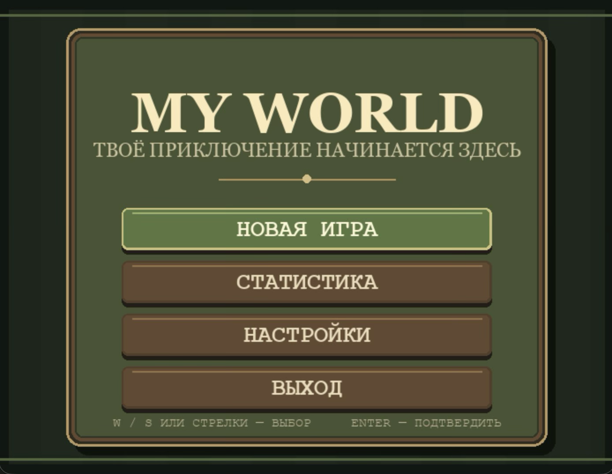
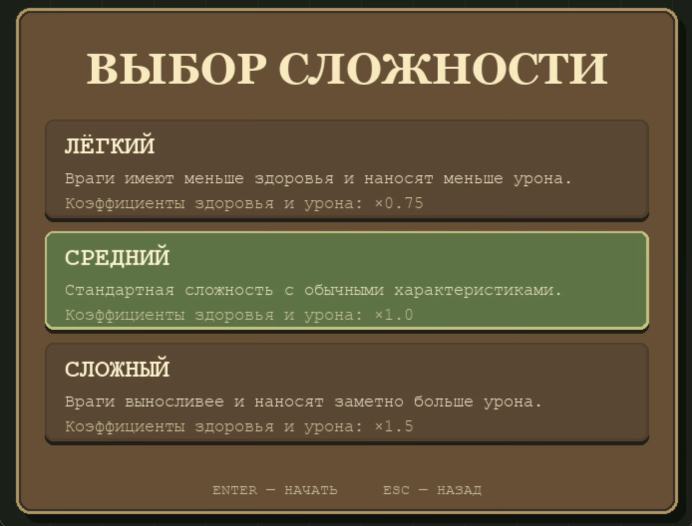
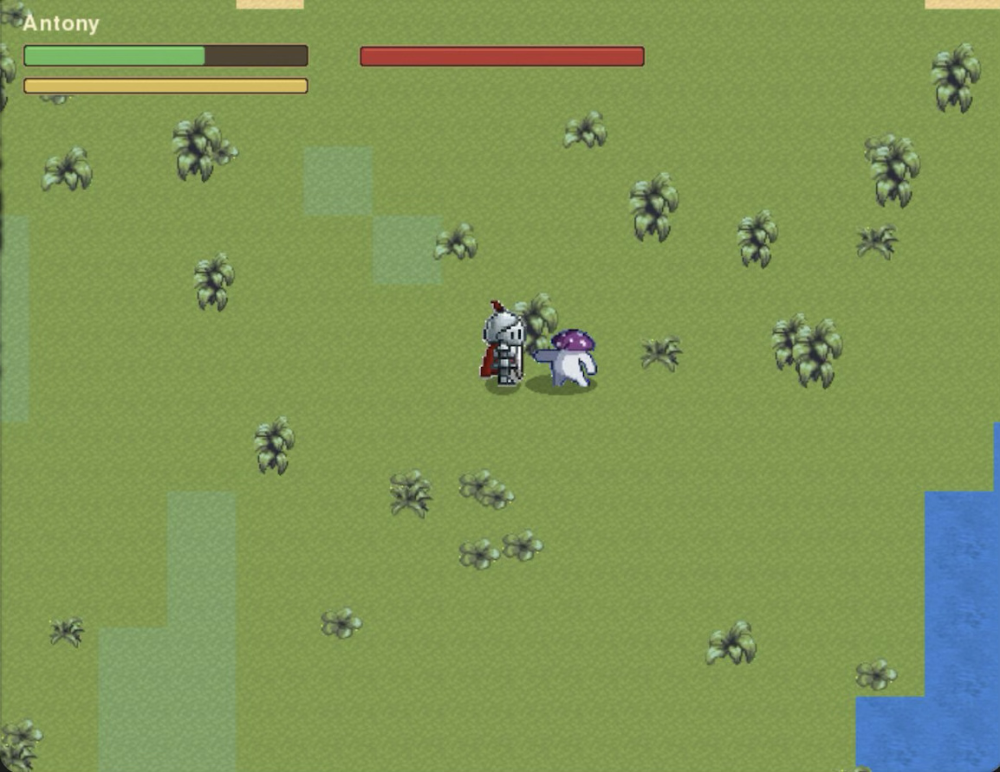
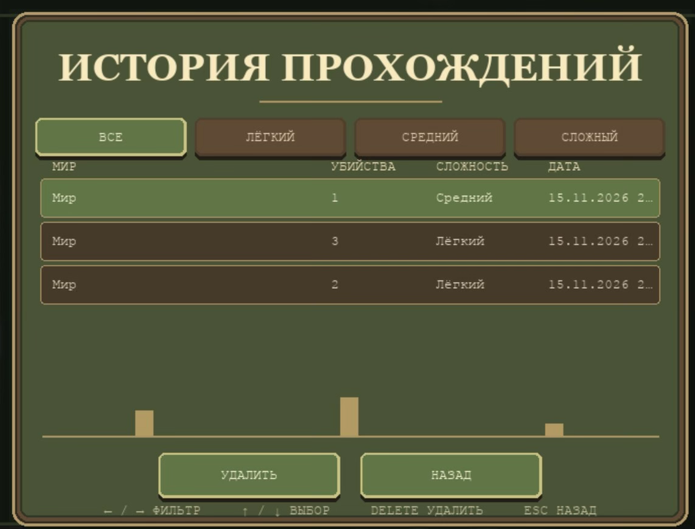

<div align="center">

# 🌍 My World

**Двумерная песочница на выживание с бесконечным процедурно генерируемым миром**

[](https://www.python.org/)
[](https://www.pygame.org/)
[](https://myworld-1999f.web.app)

[🌐 Сайт игры](https://myworld-1999f.web.app) · [⬇️ Скачать](https://myworld-1999f.web.app) · [🚀 Быстрый старт](#-быстрый-старт)



</div>

---

## 📖 Об игре

**My World** – игра с видом сверху на Python и pygame. Мир генерируется на лету
с помощью шума Перлина: пустыни, равнины, леса и озёра сменяют друг друга,
а вы исследуете карту, сражаетесь с врагами и соревнуетесь с собственными рекордами.

Проект создан в рамках учебной практики факультета прикладной математики
и информатики БГУ.

## ✨ Возможности

- 🗺️ **Бесконечный мир** – карта подгружается чанками 16×16 тайлов, генерация идёт в фоновом потоке, поэтому игра не подвисает
- 🌲 **Разные ландшафты** – вода, пустыня, равнина и лес с деревьями, кустами, цветами и камнями
- ⚔️ **Бой** – три типа врагов с преследованием, атакой и перезарядкой
- 💚 **Восстановление здоровья** – вне боя здоровье возвращается, во сне – тоже
- 🎚️ **Три уровня сложности** – меняют здоровье и урон врагов
- 📊 **Статистика прохождений** – история забегов, график убийств и фильтр по сложности
- ⏸️ **Пауза и меню** – настройки, статистика, выход с подтверждением

## 🖼️ Скриншоты

| Выбор сложности | Игровой мир |
|:---:|:---:|
|  |  |

| Статистика |
|:---:|
|  |

## 🚀 Быстрый старт

Нужен **Python 3.10 или новее**.

```bash
# 1. Клонируйте репозиторий
git clone https://github.com/antonishche/crispy-happiness.git
cd crispy-happiness

# 2. (по желанию) создайте виртуальное окружение
python -m venv .venv
# Windows:      .venv\Scripts\activate
# macOS/Linux:  source .venv/bin/activate

# 3. Установите зависимости
pip install -r requirements.txt

# 4. Запустите игру
python main.py
```

Готовый архив можно скачать и на [сайте игры](https://myworld-1999f.web.app).

## 🎮 Управление

| Клавиша | Действие |
|---|---|
| `W` `A` `S` `D` / стрелки | Перемещение |
| `Пробел` | Атака ближайшего врага |
| `Esc` | Пауза и меню |

В меню: `W`/`S` или стрелки – выбор, `Enter` – подтвердить, `Esc` – назад.

## 👾 Враги и сложность

| Враг | Здоровье | Урон |
|---|:---:|:---:|
| `mashroom` | 50 | 12 |
| `red_petyx` | 50 | 5 |
| `green_petyx` | 40 | 3 |

Сложность умножает здоровье и урон врагов: **Лёгкий ×0.75**, **Средний ×1.0**, **Сложный ×1.5**.

## 🗂️ Структура проекта

```text
.
├── main.py            # точка входа
├── game.py            # класс Game: игровой цикл и состояния
├── core/              # Entity, камера, чанки, ресурсы
├── systems/           # генерация карты, враги, статистика
├── entities/          # игрок, враги (Creature → Enemy / Player)
├── ui/                # меню, пауза, статистика, HUD
├── settings/          # константы и пользовательские настройки
├── config/ data/      # биомы, объекты, параметры существ (JSON)
└── helpers/           # вспомогательные функции
```

## 🛠️ Технологии

- **Python 3** и **pygame 2.6.1** – игровой цикл, графика, ввод
- **noise** – шум Перлина для генерации мира
- **JSON** – настройки, параметры существ и история прохождений

## 🧭 Планы

- [ ] Настройки графики и звука, смена клавиш управления
- [ ] Новые враги (маги), подземелья с боссами и сундуки
- [ ] Система очков и игровой сценарий
- [ ] Модульные тесты
- [ ] Установщик для Windows

## 👤 Автор

**Антон Альфер** – [@antonishche](https://github.com/antonishche)
